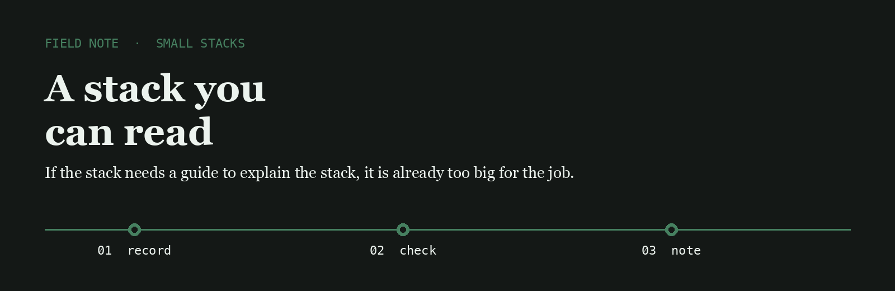
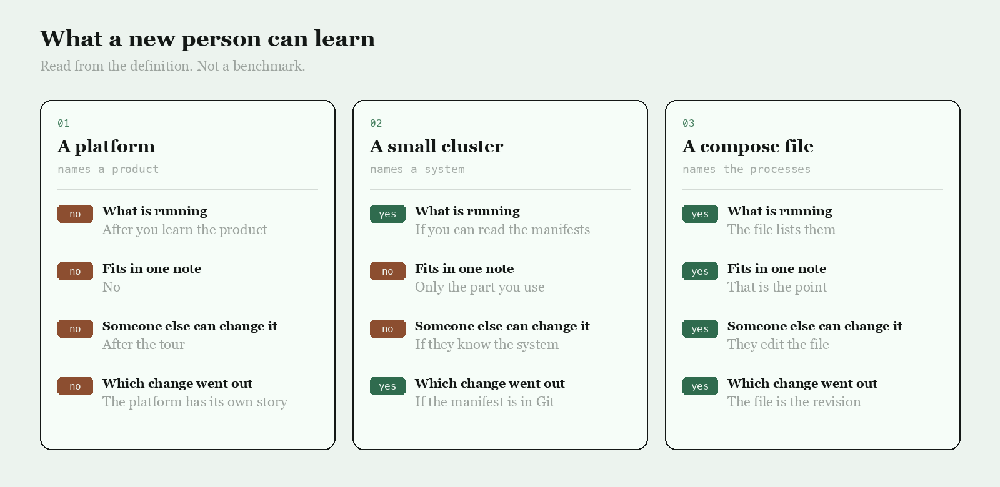

<p align="center">
  
</p>

# Stack Forge

Stack Forge is the name I use for the work of making a stack smaller until the moving parts fit in one note.

## The question

A platform, a cluster, and a compose file can all run the same three processes. I wrote down what a new person can learn from each one in an afternoon.

<p align="center">
  
</p>

|  | A platform | A small cluster | A compose file |
| --- | --- | --- | --- |
| What is running | After you learn the product | If you can read the manifests | The file lists them |
| Fits in one note | No | Only the part you use | That is the point |
| Someone else can change it | After the tour | If they know the system | They edit the file |
| Which change went out | The platform has its own story | If the manifest is in Git | The file is the revision |

## The line I keep

I keep the stack in one file and write down the revision that was up. More platform than that has to earn its place.

```text
2026-03-21T16:05:40Z  compose up  rev e09a331  three processes  exit 0
```

The runners below already start processes. The note is the decision to stop adding parts once the file can be read aloud.

- [compose](https://github.com/docker/compose) is the file I want a small stack to fit in
- [k3s](https://github.com/k3s-io/k3s) is the cluster I read when the job has outgrown one machine and not yet earned a platform
- [podman](https://github.com/containers/podman) runs the same kind of process without making the stack a product

I keep a fork of each on this account.

## What I pay attention to

- A stack whose definition fits on a page
- A process list a new person can read without a tour
- A revision that is the file, not a ticket about the file
- Tools small enough to read in one sitting

## Working with me

Send a short problem statement, a way to see it happen, and what done looks like. I am independent, remote, and usually around during the Berlin workday.
